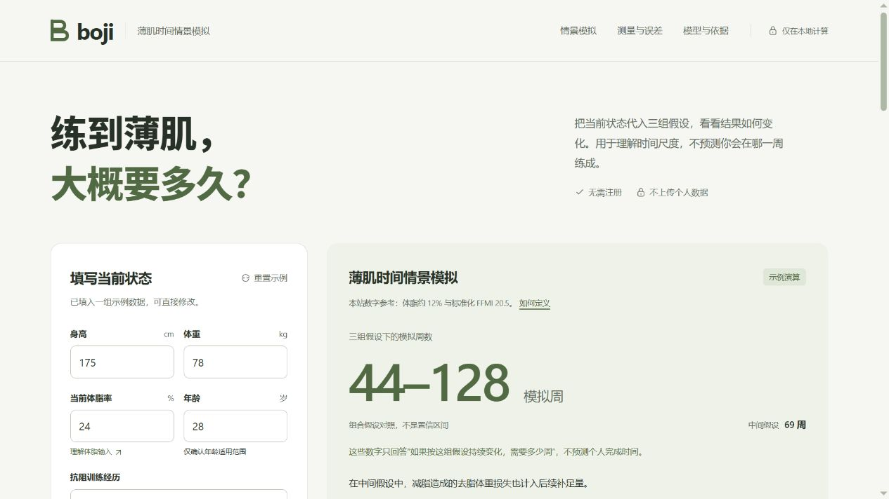

# Boji · 薄肌时间情景模拟

练到薄肌，大概要多久？

把当前身体状态代入三组假设，观察身体组成与模拟周数如何变化。用于理解时间尺度，不预测你会在哪一周练成。

**[在线体验](https://chansir-eng.github.io/boji-office/)** · [模型说明](docs/model.md) · [算法与科学性核验](docs/algorithm-audit.md) · [本地运行](#本地运行)

无需注册 · 浏览器内计算 · 不保存个人数据



## 从当前状态开始

填写身高、体重、当前体脂率、年龄、抗阻训练经历和每周力量训练次数。页面统一使用本站的薄肌数字参考，无需另设目标。

修改数据后，结果会自动更新。你可以查看：

- **三组假设**：对照审慎、中间、乐观组合下的模拟周数、阶段和变化曲线。
- **身体组成**：查看当前去脂体重与脂肪量，以及中间假设的模拟终点体重。去脂体重不等于纯肌肉。
- **输入敏感性**：把体脂输入上下改变 3 个百分点，查看去脂体重与中间假设的时间如何变化。

三组参数包含未校准的工程假设，组合名称不表示概率高低。敏感性演示也不是设备的真实误差范围或置信区间。

## 一个示例

175 cm、78 kg、24% 体脂、28 岁，新手，每周力量训练 3 次。

| 组合假设 | 减脂阶段 | 补足去脂体重 | 总模拟周数 |
| :--- | ---: | ---: | ---: |
| 审慎 | 53 周 | 75 周 | 128 周 |
| 中间 | 33 周 | 36 周 | 69 周 |
| 乐观 | 23 周 | 21 周 | 44 周 |

仅将体脂输入改为 21% 或 27%，中间假设就分别得到 33 周或 105 周。这说明输入会影响演算，不能据此确定个人完成日期。

## 薄肌如何定义

本站采用**体脂约 12%**与**标准化 FFMI 20.5**作为固定建模参考。这组数值不是官方或临床标准，也不意味着所有人都应追求同样的数值。FFMI 反映相对去脂体重，不能直接代表外观、肌肉量或健康评分。

模型依次演算减脂、补足去脂体重及必要的末段调整，顺序本身也是假设。增长表、损失比例和分段速率尚未用个人纵向数据校准；文献可解释相关概念，不能验证本计算器的个人预测能力。

单次模拟最多 520 周。未规律训练且仍需补足去脂体重时，不给出完整时长；初始或后续路径的 BMI 低于 18.5 时停止该路径。这是保守的软件护栏，不是个人健康诊断。仅部分组合可完成时，界面会明确限定结果范围。

公式、参数与适用边界见 [模型说明](docs/model.md)，数值检查与科学有效性的区别见 [核验记录](docs/algorithm-audit.md)。

## 数据与适用范围

个人参数只用于当前浏览器内的计算，不上传、不持久保存；刷新后恢复示例。站点无账户、无分析追踪、无后端服务。计算资源与字体随项目提供，页面不加载第三方图片；打开外部资料时会产生第三方请求。

当前演示面向 **18–65 岁健康成年男性**。年龄只确认适用范围，不调整增长速度。工具不提供个体诊疗建议、训练计划或个人完成时间预测。

## 本地运行

纯静态页面，无构建步骤。保留 `index.html` 与完整的 `assets/`，即可使用静态文件服务器预览：

```bash
git clone https://github.com/chansir-eng/boji-office.git
cd boji-office
python -m http.server 8000 --bind 127.0.0.1
```

打开 [http://127.0.0.1:8000](http://127.0.0.1:8000)。

安装 Node.js 后，可运行不依赖第三方库的回归检查：

```bash
node tests/calculator.test.cjs
```

更多运行、测试、部署与字体许可说明见 [开发文档](docs/development.md)。

---

Boji 是独立非官方项目。概念与研究的引用不代表相关作者认可本站。
